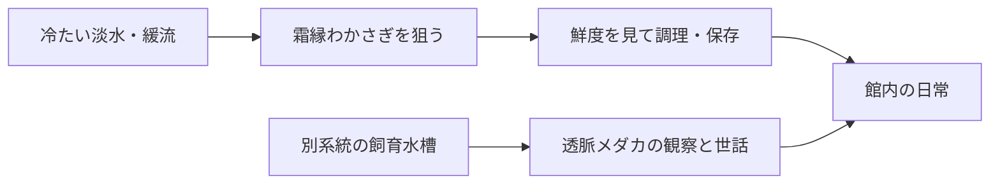
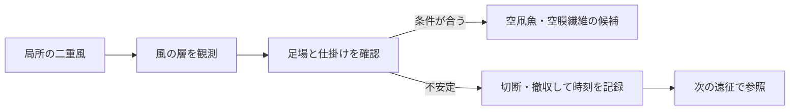
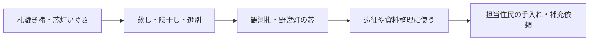

# 生態・環境の補完ルールと相関

【仮】下記は環境と暮らしをつなぐ候補。出現率、範囲、持続時間、効果量は未定。観測記録と実際の危険度は別に扱う。

## 先に区別する設定

| 項目 | 設定案 |
|---|---|
| ワールド天候・エリア急変・点状異常 | 共通の基調に、エリア単位の急変と狭い範囲の異常を重ねる。降下物や音の演出と、足場・体温・進入可否は別に設定する。 |
| 釣りの条件と難度 | 水域タグ、時刻、天候、餌、仕掛け、局所異常を出現条件に使う。難度は取り込み操作と判断の負荷。希少度・鮮度・食用可否とは独立。 |
| 魚が釣れる場所 | 水面の高さを固定せず、水域の範囲・表面・流れを使う。空釣りは別の領域にし、環境条件が合うときだけ候補を出す。 |
| 飼育個体と野生個体 | 飼育可否、食用可否、繁殖可否を種ごとに記す。野生種から派生した姿でも同じ飼育条件とは限らない。 |
| 健康と懐き | 給餌・環境で健康を維持し、触れ合いで懐きが変わる。世話不足はまず衰弱の兆候を出す。軽度で回復可能な段階と、重度・寿命を区別する。 |
| 育成と加工 | 生育中の水・光・温度は作物ごとに見る。収穫後は鮮度を管理し、乾燥・加工・保管に応じて用途が変わる。 |
| 痕跡・標本・素材 | 撮影や録音だけで完結する発見も用意する。物質化が通用しない怪異を、採取や討伐の必須条件にしない。 |

通常天候 → 釣り・飼育・食事

天候の急変 → 異常 → 観測・撤収

栽培 → 加工 → ホテルの設備

## 最初に組む候補

- ホテル内で完結する例。硝子縁レタスと瓶香はっかを育て、採り時と保存方法を比べる。透脈メダカの給餌と行動観察は別に試せる。
- 外域の通常例。釦はや・棚石はぜ・泥糸うなぎで、浅瀬、汽水、底仕掛けを分けて確認する。
- 外域の異常例。方位霧で退避、二重風では条件が揃った時だけ空釣り、灰水の皮膜は離れて撮影する。判定と演出の負荷は個別に確認する。

館内だけで滞在を楽しめることを優先する。危険な採取や希少釣果は、日常の設備や基本的な食事の必須条件にしない。

[生態・環境候補の目次](README.md)
