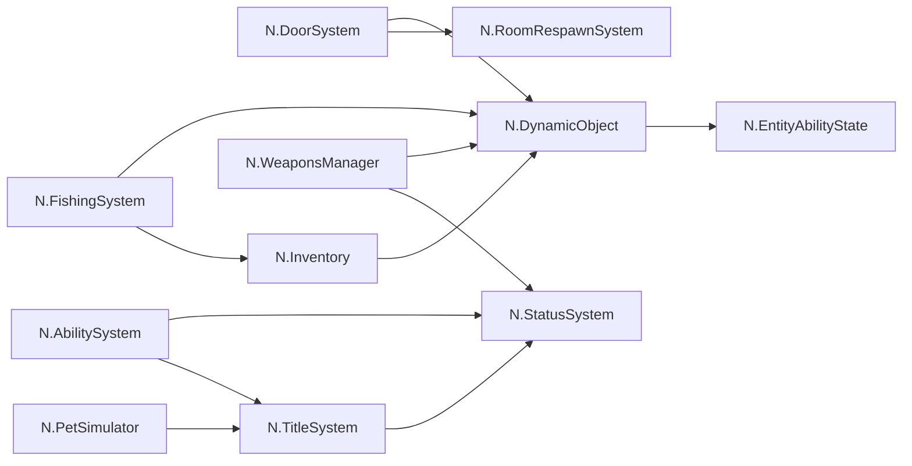

# N系ギミックと参照

矢印は参照する側から参照される側。実機での動作確認とは別です。

## 接続状況

- IntegratedMenuはメイン画面・追加2画面・ローカルポインターで構成。追加画面がメイン画面を参照します。
- Elevatorは本体と階操作盤で構成。ドアとの遷移・各階停止・乗員同期は実機確認対象です。
- N.EntityAbilityStateは個体の付与・進化状態を保持します。ObjectとEnchantmentの状態を別枠で設定します。
- NPC・Questの本接続は配置後。DriftCorrectionは保留。

## N.Scriptディレクトリ一覧

- N.AbilitySystem
- N.AdvancedWorldSettings
- N.AvatarNow
- N.BoothPoster
- N.Border
- N.CalibrationSystem
- N.CocktailLiquidSystem
- N.Console
- N.DebugVisualization
- N.DoorSystem
- N.DriftCorrection
- N.DynamicObject
- N.DynamicYamaPlayer
- N.ElevatorSystem
- N.FarmerSimulation
- N.FishingSystem
- N.FlyingSystem
- N.GimmickTransformationSystem
- N.Inventory
- N.MainMenu
- N.MixedDrinksSystem
- N.MovementSystem
- N.NavigateHierarchySystem
- N.NpcSystem
- N.PetSimulator
- N.QuestSystem
- N.RoomRespawnSystem
- N.RTabIntegration
- N.SecuritySystem
- N.StatusSystem
- N.SwimSystem
- N.TitleSystem
- N.TouchPanelUI
- N.UdonChipsExchangeSystem
- N.UdonGameChips
- N.VehicleManager
- N.VirtualInput
- N.VirtualLensWorld
- N.WaterRippleSystem
- N.WeaponsManager
- N.WelcomeSystem
- N.WIMExtensions
- N.WorldEntry
