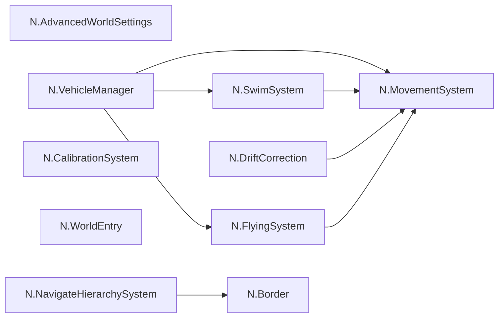
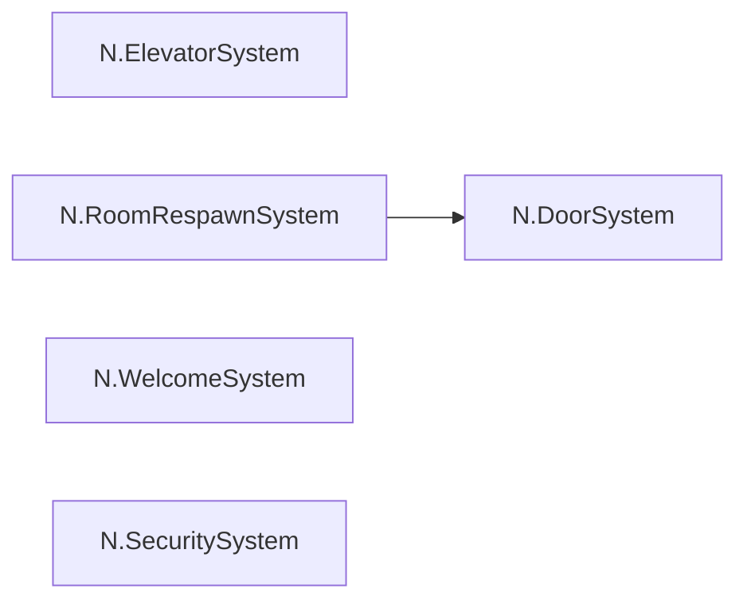
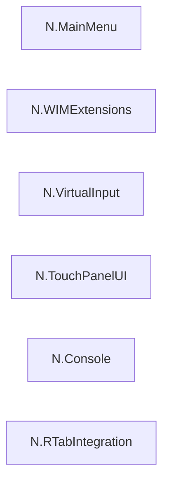
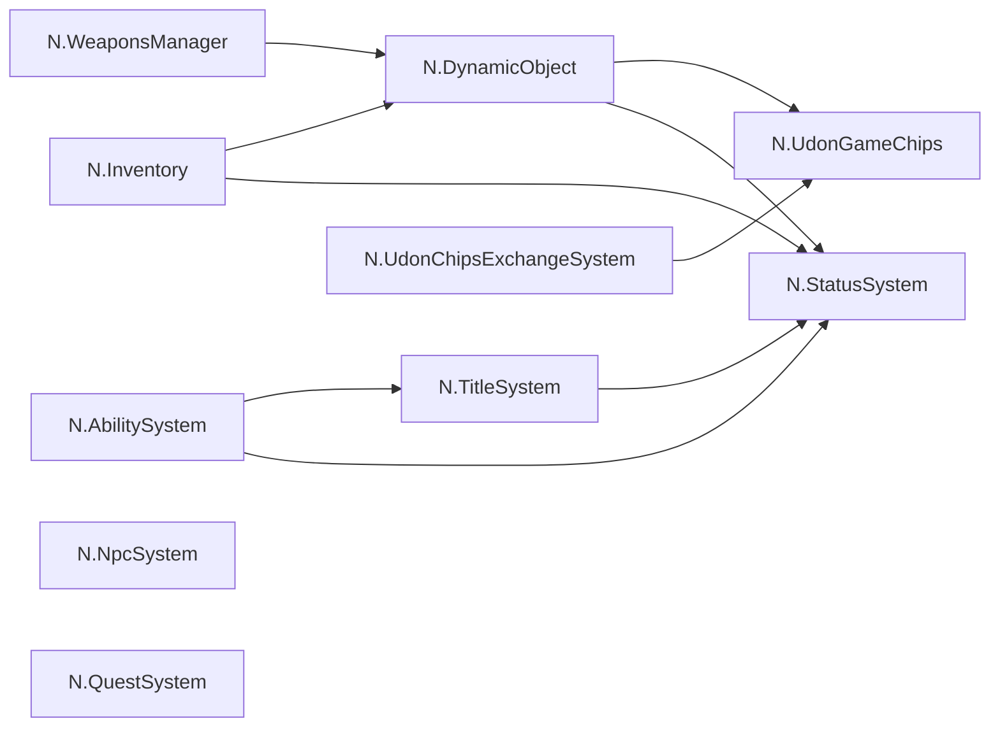
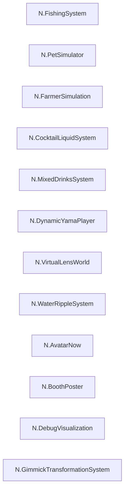
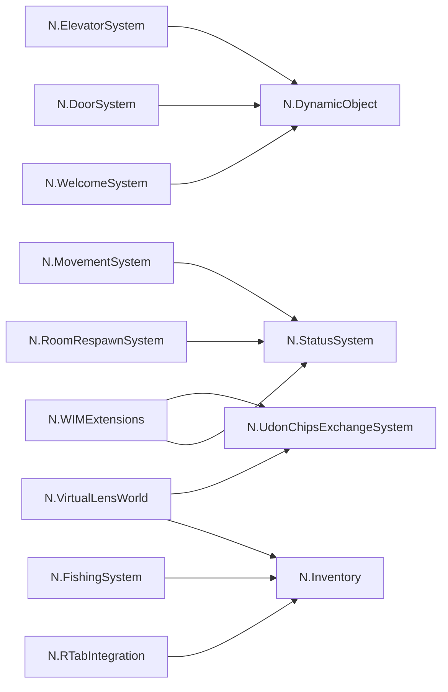

# N系ギミックの相互関係

対象は `Assets/N.Assets/N.Script` のシステムフォルダ。矢印は参照元 → 参照先です。

- [型付き参照のフィールド索引](systems/typed-reference-index.md)
- [シーンで確認した参照と保留事項](systems/scene-wiring-status.md)
- [従来のギミック資料](systems/n-gimmick-catalog.md)

## 移動・入場

| ギミック | 主な担当 |
|---|---|
| N.AdvancedWorldSettings | ワールドの移動・環境設定 |
| N.MovementSystem | 歩行・移動補正 |
| N.SwimSystem | 水泳・水中移動 |
| N.FlyingSystem | 飛行 |
| N.VehicleManager | 乗り物の移動制御 |
| N.CalibrationSystem | 入力・姿勢の校正 |
| N.DriftCorrection | スティックの校正・補正。開発保留 |
| N.WorldEntry | 入場演出・表示切替 |
| N.Border | 区域境界・通行判定 |
| N.NavigateHierarchySystem | 階層・経路案内 |

## 施設・権限

| ギミック | 主な担当 |
|---|---|
| N.DoorSystem | ドア・カード認証・操作入力 |
| N.ElevatorSystem | かご・階操作盤・移動 |
| N.RoomRespawnSystem | 個室への復帰先 |
| N.WelcomeSystem | 受付・認証カード連携 |
| N.SecuritySystem | アクセス制御・復帰処理 |

## 端末・操作

| ギミック | 主な担当 |
|---|---|
| N.MainMenu | IntegratedMenuのウィンドウ・ポインター |
| N.WIMExtensions | インベントリ・装備などの端末ページ |
| N.VirtualInput | 入力・物品情報表示 |
| N.TouchPanelUI | タッチパネル・ボタン |
| N.Console | コマンド・補助入力 |
| N.RTabIntegration | RTabアプリ・レシピ連携 |

## 個体・経済・進行

| ギミック | 主な担当 |
|---|---|
| N.DynamicObject | 物品定義・Pickup・熟練度 |
| N.Inventory | 収納・装備・クラフト・取引窓口 |
| N.WeaponsManager | 武器・取付・接着・効果 |
| N.AbilitySystem | プレイヤー能力・個体効果・素材補正・強化 |
| N.StatusSystem | 能力値・状態異常・生存 |
| N.TitleSystem | 称号条件・進行・補正 |
| N.UdonChipsExchangeSystem | 共通硬貨と娯楽通貨の交換 |
| N.UdonGameChips | 娯楽通貨残高 |
| N.NpcSystem | 住民・台詞・関係値・接触条件 |
| N.QuestSystem | 依頼・周期・進行・報酬定義 |

## 生活・制作・演出

| ギミック | 主な担当 |
|---|---|
| N.FishingSystem | 釣り竿・釣り場・モジュール・釣果 |
| N.PetSimulator | 飼育・個体能力 |
| N.FarmerSimulation | 栽培・収穫・素材特性 |
| N.CocktailLiquidSystem | カクテルの液体演出 |
| N.MixedDrinksSystem | 飲料の混合・レシピ |
| N.DynamicYamaPlayer | 動画プレイヤー連携 |
| N.VirtualLensWorld | ワールドカメラ・写真・所有 |
| N.WaterRippleSystem | 水面波紋 |
| N.AvatarNow | アバター情報 |
| N.BoothPoster | Booth向け掲示 |
| N.DebugVisualization | デバッグ用可視化 |
| N.GimmickTransformationSystem | 既存アセットをワールド用ギミックへ変換 |

図は同分類内の型付き参照を示します。分類をまたぐ参照はフィールド索引を参照してください。図で孤立したノードにも、汎用Udonイベントや外部アセットとの接続があり得ます。

## 分類をまたぐ主な接続

